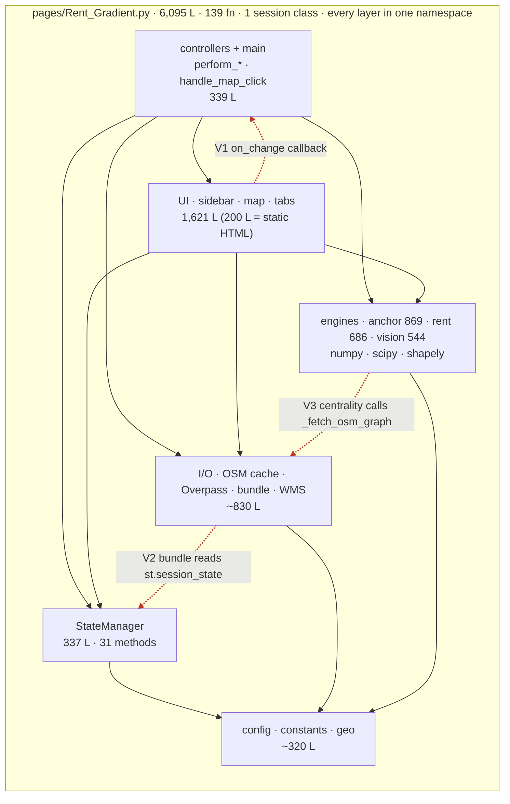
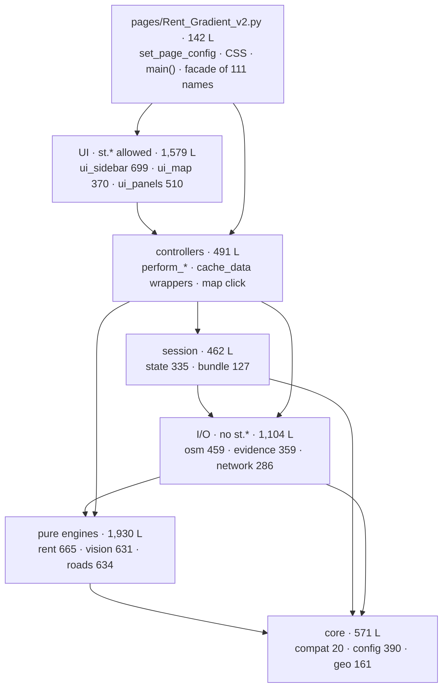
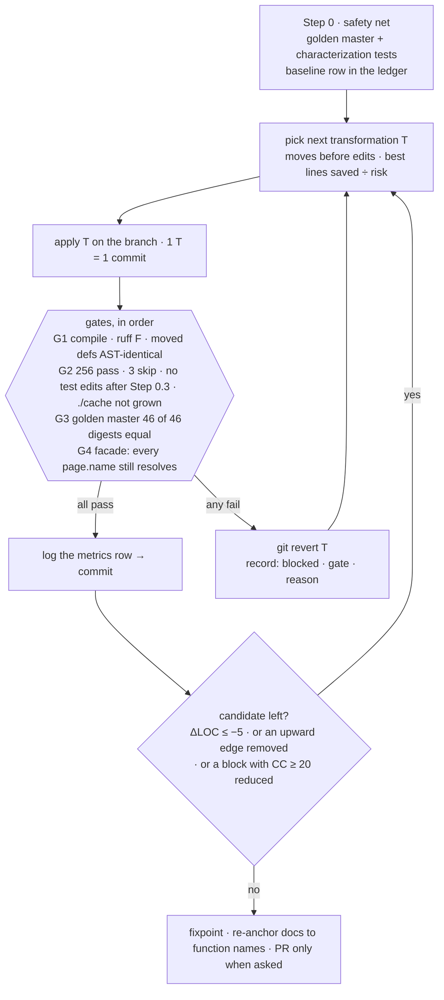

# Rent_Gradient — Refactor Plan (flowchart + loop)

> **Goal** — `loop optimize` · Refactor architecture & structure · Simplification กระชับ/สั้นสุด · **ไม่เปลี่ยน output เลย**
>
> **สถานะ**: แผน + บันทึกการลงมือ. **Step 0–2 (S-1…S-5) ทำแล้วใน PR นี้ เป็นหน้าใหม่ `pages/Rent_Gradient_v2.py` บน package `rg_lib/` — `pages/Rent_Gradient.py` ไม่ถูกแก้สักบรรทัด** (เหมือน `main` ทุก byte) และใช้เป็นตัวเทียบ. §0–§8 คือแผนกับตัวเลขที่วัดบนสำเนาตอนวางแผน (base `3c03d6c`, 6,095 บรรทัด); **ตัวเลขจริงของสิ่งที่ลงมือแล้วอยู่ใน §9** และ §0 ถูกปรับตามนั้น. ป้าย **[วัด]** = วัดแล้ว · **[ประมาณ]** = ยังไม่ได้ทำ.
>
> **พฤติกรรมอ้างอิง (ห้ามเปลี่ยน)**: `pages/Rent_Gradient_flowchart.mmd` (8 โหนด) และ `docs/rent-gradient-flowchart-facts.md` (44 facts).

## 0. สรุปสั้น

1. **ไฟล์นี้ "แน่น" ไม่ใช่ "บวม"** [วัด]: บล็อกซ้ำ 5 บรรทัดเป๊ะ ๆ มีแค่ 2 จุด · จัด format ให้ยาวขึ้นทั้งไฟล์ลดได้ ≤ 4.3% · inline ฟังก์ชันที่เรียกครั้งเดียวได้ไม่เกิน ~150 บรรทัดแต่อ่านยากขึ้น [ประมาณ]. ไม่มีไขมันก้อนใหญ่ให้ตัด — ผลที่ได้จริงมาจาก **โครงสร้าง**.
2. **"สั้นสุด" มี 3 ระดับ** — ต้องเลือกว่าวัดอะไร:

   | ตัวชี้วัด | ก่อน | หลัง | ที่มา |
   |---|---|---|---|
   | หน้า (ไฟล์ที่ Streamlit รัน) | 6,095 L (`Rent_Gradient.py`) | **142 L** (`Rent_Gradient_v2.py`; หน้าเดิมคงเดิม) | ย้ายแบบ verbatim 188 definition + บล็อก SciPy → 15 module [วัด] |
   | ไฟล์ที่ใหญ่สุดที่ต้องอ่าน | 6,095 L | 699 L (`ui_sidebar`) | [วัด] |
   | โค้ดรวมทั้งหมด | 6,095 L | 6,293 L (หน้า 142 + `rg_lib` 6,151) | การแยกเพิ่ม import/docstring +315 [วัด]; Step 2 (S-1…S-5) ลด −117 [วัด]; S-6…S-8 ≈ −25 [ประมาณ] ยังไม่ทำ |
   | จุดที่ชั้นล่างเรียกชั้นบน | 3 (4 จุดเรียก) | 0 | [วัด: `tests/test_rg_lib_layers.py`] |
   | ฟังก์ชันยาวสุด · CC สูงสุด | 456 L · 70 | เท่าเดิม (Step 3 ทางเลือก ยังไม่ได้ทำ: ≤ 150 L · ≤ 15 [ประมาณ]) | — |

3. **test เดิม 223 ตัวรับประกัน "output ไม่เปลี่ยน" ไม่ได้** [วัด]: ผ่านหมดแต่ coverage 77.6% และเมื่อจงใจแก้ output ทีละจุด (ข้อความ UI, ปัดเศษ, น้ำหนักคะแนน, กฎ invalidation, `<`/`<=`) test เดิมจับได้ **2/23** ส่วน golden master (44 digest) จับได้ **17/23** (§3.2, Appendix B) → **Step 0 ต้องมาก่อนแตะโค้ด**.
4. **ลำดับ**: Step 0 safety net → Step 1 ย้ายแบบ verbatim ตามชั้น (พิสูจน์ด้วย AST) → Step 2 simplify ภายใน module → Step 3 (เลือก) ลด CC → Step 4 แก้ docs. **1 transformation = 1 commit**; gate ไม่ผ่าน = revert. การย้ายกับการแก้ **ไม่อยู่ใน commit เดียวกัน**.
5. **ต้องให้ผู้ใช้ตัดสิน 6 ข้อ** (§7) — D1 "แยก package หรือคงไฟล์เดียว" กำหนดผลทั้งแผน.

## 1. Flowcharts

### 1.1 As-is — ทุกชั้นอยู่ใน namespace เดียว



V1 `_evidence_summary` ผูก `on_change=_on_rent_anchor_toggle` (ฝั่ง controller) · V2 `export_bundle_zip`/`import_bundle_zip` เรียก `StateManager` ทั้งที่อยู่ใน "Section 3: pure functions (No st.*)" · V3 `_compute_centrality_impl` เรียก `_fetch_osm_graph`.

### 1.2 To-be — 7 ชั้น ไหลลงทางเดียว (15 module ใน `rg_lib/` ที่ราก repo — ห้ามอยู่ใน `pages/` เพราะ Streamlit นับทุก `.py` ใน `pages/` เป็นเพจ)



ตัวเลข = บรรทัดจริงของ module ใน PR หลัง Step 2 [วัด] (รวม `rg_lib/__init__.py` 14 บรรทัด = 6,293). กติกาเดียวคือ **ห้าม import ย้อนขึ้นบน** — ชั้นบนอ่านชั้นล่างข้ามชั้นได้ (เช่น UI อ่าน `StateManager`/`rent` ตรง ๆ) ลูกศรในรูปแสดงเฉพาะลำดับหลัก. กติกานี้ตรวจโดยเครื่องมือ (mover ปฏิเสธ import ขึ้นบน; ไม่มี SCC) ไม่ใช่รูปที่วาดเอา. ชั้น "I/O" และ "pure engines" (6 module) ไม่มีโค้ดเรียก `streamlit`/`StateManager`/`session_state` เลย [วัด: grep 0 จุด].

### 1.3 Behavior contract → โค้ด → module ปลายทาง

| โหนดใน flowchart เดิม | ฟังก์ชัน | ไปอยู่ |
|---|---|---|
| ISO ① | `perform_calculation` · `calculate_intersection` · `safe_fetch_isochrone` | controllers · geo · osm |
| NET ③ | `perform_network_analysis` · `_compute_centrality_impl` · `compute_weighted_closeness` · `compute_golden_land_opportunities` | controllers · network · roads |
| ANC | `perform_automated_anchor` · `find_cbd_anchors` · `anchor_study_polygon` | controllers · roads · geo |
| EVN | `run_evidence_stage` · `classify_anchor_confidence` | evidence · vision |
| R1 ④ | `perform_rent_gradient` · `_rent_anchor_input` · `resolve_cbd_anchor` · `compute_rent_gradient_data` · `fit_rent_gradient_from_samples` | controllers · rent |
| INV | `StateManager.clear_results` · `StateManager.invalidate_inputs` (S-3) | state |
| ERR | guard ใน `perform_*` | controllers |
| GOAL | `render_analytics_panel` (Ring Report · Golden table · Markers) | ui_panels |

### 1.4 Loop



## 2. Baseline ที่วัดได้ (ก่อนแตะโค้ด)

### 2.1 ขนาดและความซับซ้อน

| มิติ | ค่า |
|---|---|
| บรรทัด LOC / SLOC / comment / blank | 6,095 / 4,806 / 308 / 700 |
| top-level function · class · method · nested def · lambda | 139 · 2 · 31 · 16 · 25 (+ 4 `st.cache_data` wrapper) |
| ฟังก์ชัน > 100 บรรทัด | 9: `find_cbd_anchors` 456 · `render_analytics_panel` 350 · `render_map` 348 · `run_evidence_stage` 215 · `_compute_centrality_impl` 154 · `build_ring_report` 135 · `_render_sidebar_network_panel` 129 · `_render_sidebar_anchor_panel` 116 · `_fetch_osm_graph` 105 — 10 ตัวใหญ่สุดรวม 2,106 L (35%) |
| Cyclomatic complexity (radon) | `run_evidence_stage` 70 (F) · `render_map` 48 (F) · `find_cbd_anchors` 46 (F) · `build_ring_report` 38 (E) · 27 block ≥ C, เฉลี่ย D (20.9) |
| บล็อกซ้ำเป๊ะ ≥ 5 บรรทัด | 2 · `ruff --select F` = 0 |
| ไม่ถูกเรียกในแอป | `TIMEOUT_GITHUB_LIST` (ไม่มีที่ใช้เลย) · เหลือไว้ให้ test/scripts: `wms_meters_per_pixel`, `_component_aspect`, `_classify_colors`, `_wms_window`, `parcel_features` |
| ขนาดตามชั้น (บรรทัดของ definition) | UI 1,621 · anchor/closeness/centrality 869 · rent 686 · vision 544 · OSM cache+bundle 496 · WMS+evidence 328 · StateManager 337 · controllers+main 339 · wrapper+KML 89 · config 264 · geo 58 |

### 2.2 Safety net ที่มีอยู่

| รายการ | ค่า |
|---|---|
| test ที่เก็บได้ | 226 — **2 ไฟล์พังตั้งแต่ collect** (`test_rent_gradient_flow.py`, `test_rent_gradient_v2.py` import เพจที่ถูกลบใน `a28ab07`/`3c03d6c`) |
| ผลฐาน (py 3.13 · streamlit 1.65 · numpy 2.5.4 · networkx 3.7 · osmnx 2.1.1) | **223 passed · 3 skipped** (ยังไม่ capture WMS fixtures) · 132 warnings · ≈ 60 s |
| test ที่แตะหน้านี้ | 171 (66 + 18 + 42 + 4 + 35 + 6); อีก 55 เป็นของ `Design.py` |
| statement coverage ของหน้านี้ | **77.6%** (2,959 stmt, พลาด 663) |
| แน่น | `run_evidence_stage` 99% · `compute_rent_gradient_data` 98% · `_evidence_summary` 98% · `find_cbd_anchors` 97% |
| **จุดบอด (< 15%)** | `perform_calculation` 3% · `safe_fetch_isochrone` 4% · `calculate_intersection` 4% · `perform_network_analysis` 4% · `_run_network_analysis_with_progress` 4% · `_parse_kml_to_geojson` 4% · `import_bundle_zip` 2% · `export_bundle_zip` 6% · `resolve_cbd_anchor` 10% · `should_add_marker` 10% · `get_fill_color` 12% — คือครึ่งแรกของ flow (① ③) + bundle |
| mutation: แก้ output เล็ก ๆ 23 แบบ (Appendix B) | test เดิมจับได้ **2/23** (เฉพาะน้ำหนัก/seed ของ anchor) · golden master จับได้ **17/23** |

### 2.3 สิ่งที่ผูกการแยกไฟล์ (ค้นพบจากการวัด — กำหนดวิธีทำ Step 1)

| ข้อจำกัด | หลักฐาน | วิธีรับมือ |
|---|---|---|
| test และ scripts โหลดเพจด้วย path (`spec_from_file_location("…", "pages/Rent_Gradient.py")`) แล้วอ่าน `page.<ชื่อ>` | 79 ชื่อที่อ่านเป็น `page.X` + `main` (AppTest เรียก `rent_gradient_test.main()`) + 5 ชื่อที่ถูก `monkeypatch.setattr(page, "…")` เท่านั้น (`CACHE_DIR` · `HAS_SCIPY` · `MAX_CACHE_ENTRY_BYTES` · `load_cached_wms_image` · `st_folium`) = **85 ชื่อ** | เพจเป็น facade: re-export 85 ชื่อ (object เดียวกับ module ต้นทาง) — G4 |
| `monkeypatch.setattr(page, "NAME", …)` แก้ได้เฉพาะ global ที่ **ฟังก์ชันอ่านจาก namespace ของเพจ** — ย้ายฟังก์ชันไป module อื่นแล้ว patch ไม่ถึง | patch 8 ชื่อ รวม **22 จุดใน 5 ไฟล์ test**: `CACHE_DIR` 9 · `_fetch_osm_graph` 3 · `st_folium` 3 · `csgraph_dijkstra` 2 · `fetch_wms_image` 2 · `HAS_SCIPY` 1 · `load_cached_wms_image` 1 · `MAX_CACHE_ENTRY_BYTES` 1. ที่เหลือ (`*_CONFIG` ผ่าน `setitem`, `ox.*`, `requests.get`, `st.session_state`, `StateManager._load_remote_defaults`) patch ที่ object ร่วม — ไม่กระทบ | helper เดียว `patch_everywhere` (patch เพจ + ทุก module ที่ถือ object เดียวกัน, เทียบด้วย `is`) — ใช้ได้ทั้งบนไฟล์เดียวและหลังแยก → ลงมือ **ก่อนย้าย** (Step 0.3) |
| ถ้าไม่ retarget: ผลที่วัดบน full split | test ไฟล์เดิมรัน 112 ตัวแรก: **11 ตัวพัง**; ตัวถัดไปไปเรียก Overpass จริงแล้วค้าง; รันทิ้งไฟล์ลง `./cache` 18–22 ไฟล์ (ทำให้ปุ่ม "Export Cache"/"ล้าง Cache" โผล่ใน UI) | G2 ตรวจ `./cache` ว่าไม่มีไฟล์เพิ่มหลังรัน |
| คลัสเตอร์ที่ **ไม่อ่าน** global ที่ test patch เลย | geo 6 fn · rent 22 fn · vision 34 fn = 62 ฟังก์ชัน ≈ 1,290 L (21%) [วัดด้วย AST: transitive] | ย้ายก่อน (Step 1a) |
| `__file__`-relative constant | `CITYPLAN_LEGEND_FILE = Path(__file__).parent.parent / …` (ถูกต่อเมื่อ package อยู่ระดับเดียวกับ `pages/`) · `_KML_FILE_PATH = Path(__file__).parent / …` **ผิดที่หลังย้าย** [วัด: เป็น 1 definition ที่ AST ต่างจากเดิม] | แก้เป็น `parent.parent / "pages" / …` ก่อนย้าย (Step 0.4, digest `kml.parse` กำกับ) |
| optional SciPy: `try: import numpy/scipy … except: HAS_SCIPY=False` ต้องไม่ทำให้ import ล้มเมื่อไม่มี SciPy | `HAS_SCIPY` ใช้ 6 จุด + `csgraph_*`, `ndi`, `np` ใน 3 ชั้น | ย้ายบล็อกเป็น `compat.py` verbatim; ชั้นอื่น import จากที่เดียว; นิยามชื่อสำรองเป็น `None` (edit แยก) |
| Streamlit รัน script เพจใหม่ทุก rerun ใน namespace ใหม่ แต่ module ที่ import ถูก cache | `_OVERPASS_LOCK = threading.RLock()` ตอนนี้ **ถูกสร้างใหม่ทุก rerun** (เลยไม่ได้กัน session ซ้อนกันจริง) → พอย้ายเป็น module จะเป็น lock ระดับ process | ผลลัพธ์เท่าเดิม แต่การรอคิวดาวน์โหลดข้าม session เปลี่ยน → D3 |
| ลำดับการวาด: `main()` วาด sidebar ก่อนรัน handler → สถานะปุ่ม (disabled) ช้ากว่าผลหนึ่ง rerun | [วัดด้วย AppTest] ปุ่ม Network ยัง disabled ทันทีหลังกด ① | **ห้ามสลับลำดับใน `main()`** (F1) |
| บรรทัดข้างเดียวที่ import แล้วไม่ใช้ใน module นั้น (re-export) ทำให้ `ruff F401` แดง | [วัด] 9 จุด (facade 4 + `compat` 5) | ติด `# noqa: F401` ที่บรรทัด re-export |

### 2.4 ของค้างใน repo (นอกตัวเพจ)

- `pages/Rent_Gradient` (57 KB, สำเนาเก่า) และ `pages/Rent_Gradient_V2` (204 KB, คอมเมนต์ทั้งไฟล์) — ไม่มี `.py` จึงไม่ถูกโหลด
- test ค้าง 2 ไฟล์ (ข้างบน) · docs ที่พูดถึงเพจที่ลบแล้ว: `rent-gradient-flow-app.md`, `rent-gradient-v2-plan.md`
- docs อ้างโค้ดด้วย **เลขบรรทัด 207 จุด** (`grep -oE '\bL[0-9]{2,4}\b'`: `facts` 79 · `flowchart-plan` 61 · `principles-review` 59 · `v2-plan` 8) — จะผิดทันทีที่บรรทัดขยับ → Step 4
- API key ของ Geoapify/Longdo ฝังใน `DEFAULT_CONFIG` (ความปลอดภัย; **ไม่แตะใน refactor นี้**, D4)

## 3. "output ไม่เปลี่ยน" แปลว่าอะไร และพิสูจน์อย่างไร

### 3.1 Frozen contract (สิ่งที่ถือเป็น output)

| # | ห้ามเปลี่ยน |
|---|---|
| F1 | ลำดับใน `main()`: `set_page_config` → CSS → `initialize` → sidebar → ① → ③ → Rent → Anchor → header/metrics/map/analytics → click · ตำแหน่ง `st.rerun()` (รวม checkbox หมุดที่ไม่ rerun และ `perform_automated_anchor` ที่ exception แล้ว return โดยไม่ rerun) |
| F2 | ข้อความ UI ทุกตัว (ไทย/อังกฤษ/emoji), label ปุ่ม (AppTest หาปุ่มด้วย label), icon ของ toast |
| F3 | key ของ `st.session_state` และ widget (`active_chk_{i}`, `del_btn_{i}`, `manual_coords`, `main_map`, `bundle_uploader`, `_bundle_bytes`, `_cache_zip_bytes`, `anchor_center_input` …) + ค่าเริ่มต้น `_DEFAULTS` + รูปแบบ `export_config` (`format_version` 2, ลำดับ key) |
| F4 | ตัวเลข: ลำดับการคำนวณ float (การบวก/เรียงลำดับ), seed (0, 1, 42), `round(·, 12)` ที่ใช้ตัดสินเสมอ, ค่าใน `*_CONFIG` |
| F5 | HTML ของ folium (หลัง normalize id), proto ของ widget, ลำดับ layer บนแผนที่ |
| F6 | รูปแบบไฟล์: `osm_graph_<md5>.pkl/.json`, `wms_<sha>.png/.json`, โครง bundle (`manifest.json`, `config/config.json`, `cache/cache.zip`, `checksums.sha256`, `README.txt`) |
| F7 | พฤติกรรมเมื่อไม่มีผล/ผิดพลาด: dict ที่คืน (`{"error": …}`), `st.error/warning/toast` ต่อกรณี |

### 3.2 Oracles — ใครพิสูจน์อะไร

| # | Oracle | พิสูจน์ | จุดบอด | ผลวัด |
|---|---|---|---|---|
| O1 | test เดิม (ไฟล์ไม่ถูกแก้ ยกเว้น Step 0.3: path ของหน้า + `patch_everywhere`) | ตัวเลขของ engine (anchor, evidence, cache, rent) | UI/ข้อความ/ปัดเศษ/invalidation, flow ① ③ | จับ mutation **2/23** |
| O2 | **golden master** (A/B ใน environment เดียวกัน) | ทุก output ที่สังเกตได้แบบ bit-for-bit: 37 เคส engine/IO + 9 เคส AppTest (widget tree, toast/error/map/state หลังคลิกแต่ละครั้ง) = **46 digest** (44 จากต้นแบบ + 2 เคสที่เพิ่มใน PR: คลิกแผนที่ · import bundle) | ผลต่างที่ไม่ปรากฏบนข้อมูลทดสอบ (equivalent mutant) | deterministic: 3 process → 44/44 เหมือนกัน · จับ mutation **17/23** · coverage รวมกับ O1 **92.3% (test เดิม 77.6% · golden master เดี่ยว ๆ 85.7%)** |
| O3 | AST-identity ของ definition ที่ย้าย | การย้ายไม่ได้แก้ definition ใด ๆ | statement ระดับ module (เช่น `CACHE_DIR.mkdir`), การ resolve ชื่อข้าม module, edit — ให้ O1/O2/O4 กัน | **พิสูจน์ได้เด็ดขาดในขอบเขตนี้** [วัด: `tests/test_rg_v2_equivalence.py` — จาก 189 definition ของหน้าเดิม 179 เหมือนเดิม · 9 แก้ (ระบุเหตุผลทีละตัว) · 1 ลบ] |
| O4 | facade check | ชื่อที่ test/scripts/golden master อ่านจากเพจ (85 + 21) resolve ได้ และ `page.X is <module>.X` | — | [วัด: suite เดิมทั้งชุดผ่านบนหน้า v2 + `test_the_names_the_page_re_exports_are_the_defining_modules_objects`] |
| O5 | compile · `ruff --select F` · layer check | ไม่มี undefined name, ไม่มี import ขึ้นบน, ไม่มี SCC, ชั้น core/engine/I/O ไม่แตะ streamlit | — | [วัด: `tests/test_rg_lib_layers.py`] |

Golden master เก็บ digest ข้าม environment ไม่ได้ (numpy/GEOS ต่างเวอร์ชัน → float ต่าง) จึงรันแบบ **A/B** ใน venv เดียวกัน: เพราะหน้าเดิมยังอยู่ใน PR นี้ จึงเทียบ `pages/Rent_Gradient.py` กับ `pages/Rent_Gradient_v2.py` ใน checkout เดียวได้เลย (แผนเดิมใช้ `git worktree` ของ commit ฐาน) แล้ว `--compare`. ค่าที่ไม่คงที่ถูก normalize (timings, `created_at_utc`, `integrity_checksums`, hash ของ `/mock/media`, id 32-hex ของ folium, ตัวเลขวินาทีใน caption).

### 3.3 Gates (รันตามลำดับ; ครบทั้งชุด ≈ 5 นาที)

```bash
# G1 static
python -m py_compile pages/Rent_Gradient_v2.py rg_lib/*.py && ruff check --select F pages/Rent_Gradient_v2.py rg_lib
# G1/G4 definition ที่ย้ายต้อง AST-identical (ยกเว้นที่ระบุเหตุผลไว้) · ชั้นล่างห้าม import ชั้นบน · core/engine/I/O ห้ามแตะ streamlit
python -m pytest -q -p no:cacheprovider tests/test_rg_v2_equivalence.py tests/test_rg_lib_layers.py
# G2 test ทั้งชุดบนหน้าเดิมและหน้า v2: 256 passed · 3 skipped (223 เดิม + 33 ใหม่) · ./cache ต้องไม่โต
IGN="--ignore=tests/test_rent_gradient_flow.py --ignore=tests/test_rent_gradient_v2.py"   # 2 ไฟล์ที่ import หน้าที่ถูกลบไปแล้ว (§2.2)
python -m pytest -q -p no:cacheprovider $IGN tests
RENT_GRADIENT_PAGE=pages/Rent_Gradient_v2.py python -m pytest -q -p no:cacheprovider $IGN tests
# G3 golden master (A/B ใน venv เดียวกัน): 46/46 digest ต้องเท่ากัน
python scripts/rg_golden_master.py pages/Rent_Gradient.py    /tmp/v1.json
python scripts/rg_golden_master.py pages/Rent_Gradient_v2.py /tmp/v2.json
python scripts/rg_golden_master.py --compare /tmp/v1.json /tmp/v2.json
```

## 4. Backlog ของ transformation

### 4.0 Step 0 — safety net (ก่อนแตะโค้ดทุกบรรทัด)

| ID | งาน | หมายเหตุ | สถานะใน PR |
|---|---|---|---|
| 0.1 | เอา test ค้าง 2 ไฟล์ออก (หรือแก้ให้โหลดเพจที่มีอยู่) | ทำให้ baseline เขียวและเทียบได้ | ยังไม่ทำ (D2) — suite รันด้วย `--ignore` สองไฟล์นั้น |
| 0.2 | เครื่องมือตรวจ: golden master (A/B) · AST-identity · facade · layers | ต้นแบบผ่านใน scratch (Appendix A) | **ทำแล้ว**: `scripts/rg_golden_master.py` · `tests/test_rg_v2_equivalence.py` (AST) · `tests/test_rg_lib_layers.py` (layers) · facade ตรวจด้วยการรัน suite เดิมทั้งชุดบนหน้า v2 |
| 0.3 | `tests/_rg_patch.py` (`patch_everywhere`, 8 บรรทัด) + แทน `monkeypatch.setattr(page, "NAME", …)` 22 จุด | ใช้ได้ทั้งบนไฟล์เดียวและหลังแยก | **ทำแล้ว** + `RENT_GRADIENT_PAGE` เลือกหน้าใน 6 test และ 3 script (ค่าเริ่มต้น = หน้าเดิม จึงไม่มีอะไรเปลี่ยนสำหรับหน้าเดิม) |
| 0.4 | `_KML_FILE_PATH` ให้ถูกต้องเมื่ออยู่ใน `rg_lib/` | edit บรรทัดเดียว; digest `kml.parse` กำกับ | **ทำแล้ว** ใน `rg_lib/config.py` (หน้าเดิมไม่ถูกแก้ จึงไม่มี commit แยก) |
| 0.5 | ปิดจุดบอด: golden master ให้ coverage +14.7 จุด (77.6% → 92.3%). ที่ยังไม่ถูกครอบคลุม: ปุ่ม import bundle จากไฟล์/GitHub, เส้นทางคลิกแผนที่จริง, `clear_disk_cache`, ทางผิดพลาดของ `perform_network_analysis`, และ 3 เคสของ mutant ที่รอด (Appendix B: กราฟ > 3,000 โหนด · anchor ถนน 250/350 ม. · โซนแดง 2×2 เซลล์) | gate ของ Step 1–3 ใช้ O1+O2 รวมกัน | **ทำบางส่วน**: เพิ่ม 2 เคส (คลิกแผนที่ · import bundle จาก GitHub และจากไฟล์ รวม 6 สถานการณ์ย่อย) = 46 digest เพราะ S-3/S-5 แตะเส้นทางเหล่านี้; ที่เหลือยังเปิดอยู่ (§9.4) |
| 0.6 | บันทึกแถวฐานใน ledger (§5) | | **ทำแล้ว** (§5) |

### 4.1 Step 1 — ย้ายแบบ verbatim (ไม่แก้ semantics ใน commit เดียวกัน)

เครื่องมือ `mover` ตัด definition ตามชื่อ **ทั้งก้อน byte-for-byte** (รวม decorator และคอมเมนต์ที่ติดอยู่ด้านบน), เติม import ให้เอง, ปฏิเสธ import ขึ้นบน, ให้เพจ re-export ชื่อเดิม, และรันเป็น stage ต่อกันได้. [วัด] 6 stage ต่อกันบน base: คอมไพล์ผ่านทุก stage · **AST ของ definition 188/189 ตัวเหมือน base** (ตัวที่ต่างคือ `_KML_FILE_PATH` ที่แก้ใน Step 0.4; เทียบกับ commit ก่อนหน้า = 189/189).

| stage | module (ล่าง→บน) | ย้าย | L [วัด] | หน้า `Rent_Gradient.py` หลัง stage | test (ไฟล์หลัง 0.3) | digest |
|---|---|---|---|---|---|---|
| 1a | `compat` · `config` · `geo` · `rent` · `vision` | บล็อก SciPy · CONFIG/สี/URL · ระยะ/polygon/CBD · Rent engine · image/zoning/parcel | 13 · 388 · 158 · 662 · 628 | 4,494 | 168 ✓ · 3 skip (แก้ test 0 จุด) | 44/44 |
| 1b | `roads` | `find_cbd_anchors` · closeness · CSR/Dijkstra | 631 | 3,887 | 168 ✓ · 3 skip | 44/44 |
| 1c | `osm` · `network` · `evidence` | cache/unpickle/Overpass/isoline · centrality+golden (V3 หายเอง: `network` อยู่เหนือ `osm`) · WMS+`run_evidence_stage` | 456 · 283 · 356 | 2,886 | 168 ✓ · 3 skip | 44/44 |
| 1d | `state` · `bundle` | `StateManager` · bundle export/import (V2 หายเอง: `bundle` อยู่เหนือ `state`) | 349 · 124 | 2,453 | (วัดรวมใน 1f) | (วัดรวมใน 1f) |
| 1e | `controllers` | `perform_*` · cache_data wrapper · KML · map click (V1 หายเอง: callback อยู่ชั้นล่างของ UI) | 488 | 2,011 | (วัดรวมใน 1f) | (วัดรวมใน 1f) |
| 1f | `ui_map` · `ui_sidebar` · `ui_panels` | `render_map` · sidebar · tabs | 458 · 704 · 507 | 421 | (วัดรวมใน 1g) | (วัดรวมใน 1g) |
| 1g | (ไม่ย้าย) trim facade | เหลือ 111 ชื่อ = 85 ที่ test/scripts ใช้ + 21 ที่ golden master ใช้ + ที่ `main()` ใช้, อัดเป็นบรรทัดหนาแน่น, ทิ้งหัวข้อ section ที่ว่างเปล่า | — | **133** (ต้นแบบ; ใน PR จัดด้วยมือ = 142) | 168 ✓ · 3 skip | 44/44 |

ตัวเลข test ของแต่ละ stage = 6 ไฟล์ที่แตะหน้านี้ (168 passed + 3 skipped = 171; อีก 55 ตัวเป็นของ `Design.py` ไม่เกี่ยว) และ `./cache` ไม่โตทุก stage. ถ้าไม่ทำ Step 0.3: stage **1a พัง 0 ตัว** (62 ฟังก์ชันที่ย้ายไม่อ่าน global ที่ถูก patch เลย), stage **1b พัง 3 ตัว** — ตรงกับ 3 จุดที่คาดไว้ (`csgraph_dijkstra` ×2, `HAS_SCIPY` ×1) [วัด].

**ใน PR นี้** การย้ายทำครั้งเดียว (commit `031c6dc`) เพราะหน้าเดิมไม่ถูกแก้ จึงไม่ต้องคงหน้าที่ใช้งานได้ระหว่างทาง — ตาราง stage ข้างบนคือผลทดลองบนสำเนาเพื่อหาว่าอะไรพังเมื่อย้ายชั้นไหน. สิ่งที่ **ต่างจาก verbatim จริง ๆ** มี 2 อย่าง (จดทั้งคู่ใน `tests/test_rg_v2_equivalence.py`): `_KML_FILE_PATH` ชี้ไป `pages/` (นิยามอยู่ลึกกว่าเดิมหนึ่งระดับ) และบล็อก SciPy ใน `compat` มีชื่อสำรอง `None` เพื่อให้ `rg_lib` import ผ่านเมื่อไม่มี SciPy เหมือนหน้าเดิม (`test_rg_lib_still_imports_when_scipy_is_missing`). `CACHE_DIR.mkdir(exist_ok=True)` ยังอยู่ที่หน้า (รันทุก rerun เหมือนเดิม) และ `evidence` ใช้ `CACHE_DIR` ตัวเดียวกับ `osm` — เทสต์ patch ถึงทั้งสองที่ด้วย `patch_everywhere`.

### 4.2 Step 2 — simplify ภายใน module (ทีละข้อ ผ่าน O1+O2)

| ID | เปลี่ยน | ΔL | ความเสี่ยง | ตัวกัน |
|---|---|---|---|---|
| S-1 | ลบ `TIMEOUT_GITHUB_LIST` (ไม่มีใครใช้) | −1 [วัด] | ไม่มี | G1 |
| S-2a | `StateManager`: ลบ alias `K_SHOW_*`/`K_CITYPLAN_OPACITY` 11 ตัวที่ใช้แค่เป็น key ของ `_DEFAULTS` | −11 [วัด] | ต่ำ | `state.accessors_and_defaults` |
| S-2b | `clear_results`: ตาราง layer→key แทน if 6 ก้อน (พฤติกรรมเท่าเดิม: layer ที่ไม่รู้จักถูกข้าม) | −17 [วัด] | ต่ำ | `state.*`, `ui.flow.marker_edits` |
| S-3 | ตั้งชื่อกฎ (a) ครั้งเดียว: `StateManager.invalidate_inputs()` แทน `clear_results([...])` ที่เหมือนกัน 8 จุด (INV ใน flowchart) | +5 [วัด] | ต่ำ | `ui.flow.*` |
| S-4 | `render_map`: helper `_geojson()` แทน `folium.GeoJson(...)` 8 ชั้น | **−91** [วัด] | กลาง | folium HTML + widget digest ทั้ง 7 เคส AppTest |
| S-5 | sidebar: `_apply_bundle()` เดียวสำหรับ import จากไฟล์/GitHub | −8 [วัด] | ต่ำ | `state.roundtrip`, `ui.flow.*` |
| S-6 | helper ปุ่ม (`_btn`/`_dl`) แทน `st.button(..., use_container_width=True, disabled=locked)` 17 จุด — และเป็นที่เดียวที่ต้องแก้เมื่อย้ายไป `width="stretch"` (D5) | ≈ −25 [ประมาณ] | ต่ำ | widget proto ใน `ui.*` |
| S-7 | HTML ของแท็บ "หลักการ" (`st.html("""…""")`, string 199 บรรทัด [วัด]) → constant `GUIDE_HTML` (ชื่อที่เสนอ) ใน `content.py` (module ที่ 16) | ≈ −200 จาก `ui_panels` (+≈ 200 ที่ `content`; รวม ≈ 0) [ประมาณ] | ต่ำ | proto ของ `st.html` ใน `ui.rich*` |
| S-8 | badge ความนิ่ง (dict ซ้ำ 2 ที่) → constant · `_base_url()` แทน normalize endpoint ซ้ำ 2 ที่ | ≈ −2 [ประมาณ] | ต่ำ | `osm.fetch_paths`, `ui.rich` |

S-1…S-5 บนต้นแบบไฟล์เดียวรวม **−123 L [วัด]** (6,095 → 5,972) — compile ผ่าน, `ruff F` ผ่าน, test (6 ไฟล์ที่แตะหน้านี้) **168 passed · 3 skipped, ./cache ไม่โต**, golden master **44/44 digest เท่าเดิม** (รวม folium HTML ของ 4 สถานการณ์ที่เปิดทุก layer).

**ผลจริงใน PR** (1 commit ต่อข้อ; golden master 44/44 ทุก commit [วัด]): S-1 −1 · S-2a −11 · S-2b −11 (ไม่ใช่ −17 ตามต้นแบบ: เขียนเป็น `layer in layers` เพื่อคงความหมายเดิมกับ container ทุกชนิด และคง docstring) · S-3 +5 · S-4 −91 · S-5 −8 = **−117**. ยังไม่ทำ: S-6…S-8 (≈ −25 บรรทัดแลกกับการแตะปุ่ม 17 จุด) และ Step 3 — รอสั่ง. S-3 และ S-5 แตะเส้นทางที่ test เดิมกับ 44 digest แรกไม่ครอบคลุม (คลิกแผนที่, import bundle) จึงเพิ่ม 2 เคสใน golden master (46 digest) แล้วรันบนหน้าเดิมก่อน (2 รอบ ผลเหมือนกัน) จึงเทียบกับ v2: เท่ากัน; mutant ที่ใส่เจตนา (ไอคอน toast ผิด · ลืม `st.rerun()` · ลืมล้าง layer rent) ทำให้ digest เปลี่ยน.

### 4.3 Step 3 — ลดความซับซ้อน (ทางเลือก; ไม่ลดบรรทัด)

| ID | เป้า | CC ก่อน → หลัง [ประมาณ] | ตัวกัน |
|---|---|---|---|
| C-1 | `run_evidence_stage` → 5 stage helper (plan · region · parcel · clusters · confidence) คืน dict เล็ก; `return finish(...)` 8 จุดคงเห็นชัด | 70 → ≤ 15 | `evidence.stage` (4 สถานการณ์) + test เดิม 66 ตัว |
| C-2 | `find_cbd_anchors`: closure 8 ตัวที่แชร์ตัวแปรร่วม → class `_AnchorSearch` (ลำดับการคำนวณ float **เหมือนเดิมทุกประการ**) | 46 → ≤ 12 | `anchors.*` (7 เคส: grid/real, screened, stability on/off) — bit-for-bit |
| C-3 | `render_analytics_panel` → `_tab_curve/_rings/_gold/_marks/_theory` | 22 → ≤ 6 | `ui.rich*` |
| C-4 | `build_ring_report` → ตัวสร้างแถวต่อวง + แถวนอกวง | 38 → ≤ 10 | `rent.ring_report` (8 สถานการณ์) |
| C-5 | `_fetch_osm_graph` → แยก `exact_hit`/endpoint list เป็นฟังก์ชัน | 16 → ≤ 8 | `osm.fetch_paths` + `tests/test_osm_failover.py` |

ทำเฉพาะเมื่อผู้ใช้ให้ค่ากับ CC มากกว่าความเสี่ยง — C-2 เสี่ยงสุด (ตัวเลข) และไม่ลดบรรทัด.

### 4.4 ที่ลองวัดแล้ว **ไม่เอา**

| ไอเดีย | ผลวัด | เหตุผล |
|---|---|---|
| format ให้ยาว (`ruff format`, ตัด magic trailing comma) | 88 col → 7,314 L · 100 → 6,734 · 120 → 6,166 · **140 → 5,832 (−4.3%)**; AST เหมือนเดิม | diff ทั้งไฟล์ ทำลาย `git blame` แลกกับ −4% |
| inline ฟังก์ชันที่ถูกเรียกครั้งเดียว | 40 ตัว ≲ 150 L [ประมาณ] | ฟังก์ชันที่ตั้งชื่อดีมีค่ามากกว่า 3–4 บรรทัดที่ได้ |
| helper สำหรับบล็อก 4–5 บรรทัดที่ซ้ำ 2 ที่ (`_rent_span`, `_add_marker_and_rerun`) | ≈ 0 L (helper = ที่ประหยัด) | ไม่สั้นลง |
| ลบ getter ของ `StateManager` 12 ตัว | −48 L แต่เปลี่ยน ~40 จุดเป็น key string | แลกการกันพิมพ์ผิดกับ 48 บรรทัด |

## 5. Loop (ทำซ้ำจนถึง fixpoint)

1. เลือก T ถัดไป: **ย้ายก่อนแก้**; ในกลุ่มเดียวกันเลือก (บรรทัดที่ลด ÷ ความเสี่ยง) สูงสุด.
2. ใช้ T บน branch เป็น **1 commit** (ชื่อ commit บอก ID: `refactor(S-4): …`).
3. ผ่าน G1→G4 ตามลำดับ; ผิดข้อไหน → `git revert`, จดลง ledger ว่า *blocked · gate · เหตุผล*, ไปข้อต่อไป.
4. บันทึกแถว ledger: ชนิด · LOC หน้า · LOC รวม · upward edge · test · digest · AST (+ #fn และ max CC จาก `radon` — ฐาน 139 fn · CC 70 — เพิ่มเป็นคอลัมน์ตอนทำจริง).
5. **หยุดเมื่อ** ไม่เหลือ candidate ที่ ΔLOC ≤ −5 หรือเอา upward edge ออกได้ หรือลด block ที่ CC ≥ 20 → fixpoint → Step 4.

| commit | ชนิด | L หน้า v2 | L `rg_lib` | L รวม | upward | digest | definition ของหน้าเดิม: เหมือน / แก้ / ลบ |
|---|---|---|---|---|---|---|---|
| base `3c03d6c` | — | (หน้าเดิม 6,095) | — | 6,095 | 3 | 44/44 (อ้างอิง) | 189 / 0 / 0 |
| `031c6dc`…`4bc7a70` | move + test + tool | 142 | 6,268 | 6,410 | **0** | 44/44 | 188 / 1 / 0 |
| S-1 `c7ac6cd` | edit | 142 | 6,267 | 6,409 | 0 | 44/44 | 187 / 1 / 1 |
| S-2a `64e4281` | edit | 142 | 6,256 | 6,398 | 0 | 44/44 | 186 / 2 / 1 |
| S-2b `101d1f3` | edit | 142 | 6,245 | 6,387 | 0 | 44/44 | 186 / 2 / 1 |
| S-3 `f3c8ce0` | edit | 142 | 6,250 | 6,392 | 0 | 44/44 | 181 / 7 / 1 |
| S-4 `59432d5` | edit | 142 | 6,159 | 6,301 | 0 | 44/44 | 180 / 8 / 1 |
| S-5 `fe8bb02` | edit | 142 | 6,151 | 6,293 | 0 | 44/44 | 179 / 9 / 1 |
| HEAD (golden master ขยายเป็น 46) | tool | 142 | 6,151 | 6,293 | 0 | **46/46** | 179 / 9 / 1 |

หมายเหตุ: **ทุกแถว** ผ่าน compile · `ruff --select F` · `tests/test_rg_v2_equivalence.py` + `tests/test_rg_lib_layers.py` (33 ตัว) และ golden master (รันแยกต่อ commit ใน worktree ของ commit นั้น). **pytest เต็มชุด** รันที่ `4bc7a70` และ `fe8bb02` (ปลายทางของ Step 2): ทั้งสองครั้ง **256 passed · 3 skipped บนทั้งหน้าเดิมและหน้า v2, `./cache` ไม่โต** (256 = 223 เดิม + 33 ใหม่). 3 skipped คือ WMS fixtures ที่ยังไม่ได้ capture (เท่ากับ baseline). คอลัมน์ "L หน้า v2" คงที่เพราะ Step 2 แตะแต่ `rg_lib`. ถ้าทำ S-6…S-8 / Step 3 ต่อ ให้เพิ่มแถวตามวิธีใน loop ข้างบน.

## 6. ความเสี่ยงที่รู้แล้ว และวิธีกัน

| ความเสี่ยง | กัน |
|---|---|
| float เปลี่ยนที่หลักท้าย ๆ จากการเรียงลำดับการบวกใหม่ | golden master เทียบ `repr(float)` ตรง ๆ (ไม่ใช้ `approx`) — **แต่** mutant M02 (สลับลำดับ fsum ใน OLS) รอด เพราะข้อมูลทดสอบไม่ไวต่อมัน ⇒ ห้ามแตะลำดับการบวก/เรียงเลย (C-2 ระบุไว้) ไม่ปล่อยให้ oracle ตัดสินแทน |
| patch ไม่ถึงหลังย้าย → test ผ่านเพราะไม่ได้ patch (หรือค้างบน network จริง) แล้วเขียนไฟล์จริงลง `./cache` | 0.3 `patch_everywhere` + G2 ตรวจ `./cache` ไม่โต |
| `st.cache_data` key เปลี่ยนเพราะ module/qualname ใหม่ | แค่ cache miss ครั้งแรก — ผลเท่าเดิม (ttl 3600 s) |
| import ล้มตอนไม่มี SciPy | `compat` verbatim + นิยามชื่อสำรอง `None` (edit แยก, ทดสอบด้วย `HAS_SCIPY=False`) |
| golden master พลาดช่องที่ไม่ได้ครอบคลุม | ledger บันทึก coverage รวมทุกรอบ; ช่องที่เหลือ (3 test skipped = WMS fixtures จริง) ระบุไว้ใน PR |
| เลขบรรทัดใน docs ผิดหลังบรรทัดขยับ | Step 4: ใช้ `module.function` แทน |

## 7. สิ่งที่ผู้ใช้ต้องตัดสิน

| # | คำถาม | แนะนำ | ใน PR นี้ |
|---|---|---|---|
| D1 | แยกเป็น package `rg_lib/` (15 ไฟล์) หรือคงไฟล์เดียว? | **แยก** — ถ้าไม่แยก: Step 0 + 2 + 3 ในไฟล์เดียว ได้ ≈ −2.5% และยังเหลือ 3 upward edge | **แยก**, และสร้างเป็น **หน้าใหม่** `Rent_Gradient_v2.py` ข้างหน้าเดิม (ตามที่ผู้ใช้สั่ง: ไม่ทับของเก่า) |
| D2 | ลบของค้าง §2.4 (`pages/Rent_Gradient`, `pages/Rent_Gradient_V2`, test ค้าง 2, docs V2/Flow 2)? | ลบ (ประวัติอยู่ใน git) | ยังไม่ทำ (ไม่ได้ถูกสั่ง) |
| D3 | `_OVERPASS_LOCK` กลายเป็น lock ระดับ process จริง (ผลลัพธ์เท่าเดิม, การรอคิวเปลี่ยน) | ยอมรับ — เป็นเจตนาที่คอมเมนต์เดิมเขียนไว้ | **เกิดขึ้นแล้วใน v2** (§9.3) |
| D4 | API key ที่ฝังใน `DEFAULT_CONFIG` | แยกงาน: ย้ายไป `st.secrets`/env (เปลี่ยน default → นอก refactor) | ไม่แตะ (ย้ายไป `rg_lib/config.py` ตามเดิม) |
| D5 | `use_container_width` 24 จุด (Streamlit 1.65 เตือน "removed after 2025-12-31") | งานเข้ากันได้แยกต่างหาก ทำหลัง S-6 ที่เดียว | ไม่แตะ (24 จุดเท่าหน้าเดิม) |
| D6 | เพิ่มเครื่องมือ 4 สคริปต์ + golden master เข้า `scripts/` และ `tests/_rg_patch.py`? | เพิ่ม (Step 0.2–0.3) | เพิ่ม golden master เป็น script + AST/layer เป็น pytest + `_rg_patch.py`; mover/mutation ยังอยู่ใน scratch |

## 8. การส่งมอบ

- Branch `claude/great-lovelace-lxdmck`, commit ตาม ledger (§5); PR เปิดตามที่ผู้ใช้สั่ง.
- Step 4 (docs) ยังไม่ทำ: แทนเลขบรรทัด 207 จุดด้วย `module.function` แล้วเขียนสคริปต์ตรวจด้วย AST ว่าทุกฟังก์ชันที่อ้างยังมีอยู่ (ยังไม่มีสคริปต์แบบนี้ใน repo); จัดการเอกสาร V2/Flow ตาม D2.
- Definition of done: ledger ครบ ✓ · gate ใน §3.3 เขียว ✓ · `wc -l pages/Rent_Gradient_v2.py` = 142 · upward edge = 0 ✓ · docs ไม่มีเลขบรรทัด ✗ (Step 4).

## 9. ผลการลงมือใน PR นี้

PR สร้างหน้า **`pages/Rent_Gradient_v2.py`** (แท็บใหม่ "Rent Gradient v2") ข้างหน้าเดิม โดย **ไม่แตะ `pages/Rent_Gradient.py`** (`git diff origin/main -- pages/Rent_Gradient.py` ว่าง).

### 9.1 สิ่งที่เพิ่ม/แก้ (31 ไฟล์: 22 ใหม่ · 9 แก้ — `git diff --stat origin/main`)

| ไฟล์ | หน้าที่ |
|---|---|
| `pages/Rent_Gradient_v2.py` (142 L) | หน้าใหม่: `main()` เดิมทุกตัวอักษร + import ที่ re-export 111 ชื่อให้ test/script เดิมอ่านจากเพจได้ |
| `rg_lib/` (15 module + `__init__`, 6,151 L) | โค้ดของหน้าเดิมแยกตามชั้น (§1.2) |
| `tests/test_rg_lib_layers.py` · `tests/test_rg_v2_equivalence.py` | กฎชั้น · "v1 == v2" ระดับ AST (33 test, ~7 s) |
| `tests/_rg_patch.py` + แก้ 6 test และ 3 script | รัน suite เดิมกับหน้าไหนก็ได้ด้วย `RENT_GRADIENT_PAGE` (ค่าเริ่มต้น = หน้าเดิม) |
| `scripts/rg_golden_master.py` | golden master 46 digest (`--compare`) |
| `docs/Rent_Gradient_flowchart_Refactor_plan.md` | เอกสารนี้ |

### 9.2 ผลวัด (environment เดียวกัน: Python 3.13 · Streamlit 1.65 · pandas 2.3.3 · numpy 2.5.4 · networkx 3.7 · osmnx 2.1.1)

| ตรวจ | ผล |
|---|---|
| pytest เต็มชุดบนหน้าเดิม | 256 passed · 3 skipped · `./cache` ไม่โต |
| pytest เต็มชุดบนหน้า v2 (`RENT_GRADIENT_PAGE=pages/Rent_Gradient_v2.py`) | 256 passed · 3 skipped · `./cache` ไม่โต |
| golden master หน้าเดิม vs v2 | **46/46 digest เท่ากัน** (44 ตัวแรกเท่ากับที่จับไว้ก่อนแก้อะไรเลย; หน้าเดิมรัน 2 รอบเท่ากัน) |
| golden master ทีละ commit ของ Step 2 | 44/44 ทุก commit (S-1 … S-5) |
| AST ของ definition หน้าเดิม 189 ตัว | 179 เหมือนเดิม · 9 แก้ (มีเหตุผลกำกับ) · 1 ลบ; ใหม่ 2 (`_geojson`, `_apply_bundle`) + `ROOT` ในหน้า |
| ชั้น | 0 import ขึ้นบน · core/engine/I/O ไม่แตะ streamlit · `rg_lib` import ผ่านเมื่อไม่มี SciPy |
| เบราว์เซอร์จริง (Streamlit 1.65 + Chromium headless, ทั้งสองแท็บในเมนูซ้าย) | โหลดหน้า + เพิ่มหมุดผ่านช่อง "Coords": ข้อความ sidebar/main · รายการปุ่ม · alert เท่ากัน, ไม่มี exception, screenshot เท่ากันทุก pixel นอกรายการเมนูที่ถูกเลือก (ยกเว้น 2×14 px ที่ขอบ checkbox หลังเพิ่มหมุด = transition) |

### 9.3 ความต่างของพฤติกรรมที่ตั้งใจ / ที่ควรรู้

1. **`_OVERPASS_LOCK` เป็น lock ระดับ process จริง.** Streamlit รัน script ของหน้าใหม่ทุก rerun จึงสร้าง `threading.RLock()` ใหม่ทุกครั้ง (หน้าเดิมไม่เคยกันข้าม session จริง); ใน `rg_lib` ถูกสร้างครั้งเดียว. ผลของ session เดียวเท่าเดิม; หลาย session ที่ดาวน์โหลด Overpass พร้อมกันจะต่อคิวและไม่แย่งแก้ `ox.settings.overpass_url` — ตรงกับคอมเมนต์ใน `_fetch_osm_graph` (fast path อยู่นอก lock, re-check ใน lock).
2. **ทั้งสองแท็บใช้ `st.session_state` ร่วมกัน** (key เดียวกัน): ผลที่คำนวณในแท็บหนึ่งเห็นในอีกแท็บ.
3. **`st.cache_data` แยกกัน** (key ผูกกับฟังก์ชัน/โมดูล): เปิด v2 ครั้งแรกคำนวณใหม่ (ttl 3600 s), ผลเท่าเดิม.
4. **API ภายในของ `StateManager`:** alias `K_SHOW_*`/`K_CITYPLAN_OPACITY` ถูกลบ (key เดิมไม่เปลี่ยน), เพิ่ม `invalidate_inputs()` และ `_LAYERS`.
5. **ชื่อไฟล์:** `Rent_Gradient_v2.py` (v ตัวเล็ก) — บน macOS/Windows (ชื่อไฟล์ไม่แยกตัวพิมพ์) จะชนกับ `Rent_Gradient_V2.py` ที่ถูกลบไปแล้ว ทำให้ `tests/test_rent_gradient_v2.py` ที่ค้าง (ซึ่ง import หน้า V2 เก่าและพังอยู่แล้ว) ไปโหลดหน้านี้แทน.

### 9.4 ยังไม่ได้ทำ / ต่อยอด

- D2 (ลบของค้าง) · Step 0.1 · Step 0.5 ส่วนที่เหลือ (กราฟ > 3,000 โหนด · anchor ถนนห่าง 250/350 ม. · โซนแดง 2×2 เซลล์ [M21–M23]; ปุ่ม export/ล้าง cache; ทางผิดพลาดของ `perform_network_analysis`) · S-6…S-8 · Step 3 · Step 4 · D4 · D5.
- เมื่อพอใจแล้วเลิกใช้หน้าเดิม: ลบ `pages/Rent_Gradient.py` และ `tests/test_rg_v2_equivalence.py` (ข้ามการเทียบเองเมื่อไม่มีหน้าเดิม) แล้วเปลี่ยนค่าเริ่มต้นของ `RENT_GRADIENT_PAGE` เป็น v2.

### 9.5 ทบทวน / ทำซ้ำ

- โครงสร้าง: `rg_lib/__init__.py`. อะไรต่างจากหน้าเดิม: `INTENTIONAL_CHANGES` / `REMOVED` / `ADDED` ใน `tests/test_rg_v2_equivalence.py` (ทุกรายการมีเหตุผล).
- ทำซ้ำทั้งหมด: คำสั่งใน §3.3.

## Appendix A — เครื่องมือ: ตอนนี้อยู่ที่ไหน

| เครื่องมือ | ทำอะไร | ผลที่วัด | ตอนนี้ |
|---|---|---|---|
| `golden_master.py` | 37 เคส engine/IO + AppTest → digest ต่อเคส; `patched()` รู้จัก alias ข้าม module | 44 digest ≈ 45 s; 3 process เหมือนกันทุกตัว | **ใน repo**: `scripts/rg_golden_master.py` (46 digest ≈ 75 s, มี `--compare`) |
| `mutants.py` | 23 mutant (น้ำหนักคะแนน, ปัดเศษ, ข้อความ, style แผนที่, กฎ invalidation, `<`/`<=`, ลำดับ float, พารามิเตอร์ engine …) แต่ละตัวสร้างต้นไม้ของ repo แล้วรันทั้ง test เดิมและ golden master | test เดิมจับ **2/23** · golden master **17/23** | scratch เท่านั้น (ผลอยู่ใน Appendix B) |
| `mover.py` | ตัด definition ตามชื่อ → module (verbatim), รันเป็น stage, ตรวจ DAG | 195 ชื่อ → 15 module | scratch เท่านั้น: ใช้สร้าง `rg_lib/` ครั้งเดียว; `tests/test_rg_v2_equivalence.py` พิสูจน์ผลลัพธ์แทน |
| `astcheck.py` | เทียบ `ast.dump` ของทุก definition ก่อน/หลัง | 189 definition | **ใน repo**: `tests/test_rg_v2_equivalence.py` |
| `facadecheck.py` | ชื่อที่ test/scripts ใช้ resolve ได้และเป็น object เดียวกัน | 85 ชื่อ · 0 missing | ครอบด้วย suite เดิมบนหน้า v2 + `test_the_names_the_page_re_exports_are_the_defining_modules_objects` |
| `modules.py` | call graph (ไม่มี SCC) · import ขึ้นบน · ฟังก์ชันที่อ่าน global ที่ test patch | V1–V3 | **ใน repo**: `tests/test_rg_lib_layers.py` (กฎเดียว: import ลงล่างเท่านั้น) |
| `trim_facade.py` | เหลือเฉพาะ import ที่เพจ / test / golden master ใช้ | 421 → 133 L | scratch เท่านั้น (หน้า v2 จัดด้วยมือ → 142 L) |

## Appendix B — Mutation: ใครจับอะไรได้

แก้ output ทีละจุดบนสำเนา แล้วดูว่า oracle ตัวไหนเห็น (K = จับได้, – = ไม่เห็น). golden master จับ 17/23; ที่รอด 6 ตัวแบ่งเป็น **equivalent บนข้อมูลทดสอบ 3 ตัว** (M02, M11, M17 — ผลเท่าเดิมจริง) กับ **จุดบอดที่รู้แล้ว 3 ตัว** (M21–M23) ซึ่งปิดได้ใน Step 0.5: กราฟ > 3,000 โหนดเพื่อใช้ค่า default ของ pivot/betweenness · anchor ถนนที่ห่าง 250/350 ม. เพื่อขอบ 300 ม. · โซนแดงขนาด 2×2 เซลล์พอดีเพื่อขอบ 4 เซลล์.

| mutant | เปลี่ยนอะไร | test เดิม | golden master |
|---|---|---|---|
| `M01_golden_weight` | golden-land weight drift | – | K |
| `M02_fsum_order` | float summation order in the OLS | – | – |
| `M03_ring_pct_round` | rounding of % nodes | – | K |
| `M04_header_caption` | UI caption text | – | K |
| `M05_cbd_fill_opacity` | map style value | – | K |
| `M06_clear_intersection` | invalidation rule dropped | – | K |
| `M07_no_rent_refresh_after_net` | handler skips the rent refresh after the network | – | K |
| `M08_intersection_lt` | off-by-one in the CBD intersection guard | – | K |
| `M09_predict_rent_form` | algebraically equal formula, different float | – | K |
| `M10_error_text` | message wording | – | K |
| `M11_kml_polygon_min` | KML polygon vertex guard | – | – |
| `M12_fill_boundary` | boundary of the first travel-time bucket | – | K |
| `M13_debounce_cmp` | debounce comparison | – | K |
| `M14_bundle_msg` | bundle error wording | – | K |
| `M15_fallback_radius` | evidence fallback radius | – | K |
| `M16_ring_area_segments` | circle polygon resolution | – | K |
| `M17_density_tolerance` | density tolerance (likely equivalent on the test graphs) | – | – |
| `M18_marker_popup` | popup wording on the map | – | K |
| `M19_anchor_weight` | composite degree weight 0.30 -> 0.31 | K | K |
| `M20_reference_seed` | reference sample seed 0 -> 1 | K | K |
| `M21_pivot_count` | closeness pivots 600 -> 599 | – | – |
| `M22_agree_radius` | road/evidence agree radius 300 -> 400 m | – | – |
| `M23_zone_min_cells` | peak zone minimum cells 4 -> 5 | – | – |

## Appendix C — วัดซ้ำได้อย่างไร

```bash
python3 -m venv .venv && .venv/bin/pip install 'pandas>=2.2,<3' 'pyarrow>=14,<22' 'streamlit>=1.50' networkx osmnx shapely scipy pyproj plotly \
    folium streamlit-folium matplotlib pillow requests_cache geopy numba pytz pytest pytest-timeout coverage radon ruff vulture
.venv/bin/python -m pytest -q -p no:cacheprovider --ignore=tests/test_rent_gradient_flow.py --ignore=tests/test_rent_gradient_v2.py tests   # 223 passed · 3 skipped
.venv/bin/python -m coverage run --branch --include=pages/Rent_Gradient.py -m pytest -q tests/test_anchor_evidence.py \
    tests/test_anchor_stability_and_cache.py tests/test_automated_anchor.py tests/test_osm_failover.py \
    tests/test_rent_gradient_principles.py tests/test_wms_fixtures.py && .venv/bin/python -m coverage report -m   # 77.6% (stmt)
.venv/bin/radon cc -s -a -nC pages/Rent_Gradient.py && .venv/bin/radon raw pages/Rent_Gradient.py          # CC · LOC
.venv/bin/ruff check --select F pages/Rent_Gradient.py && .venv/bin/vulture pages/Rent_Gradient.py --min-confidence 60
```
